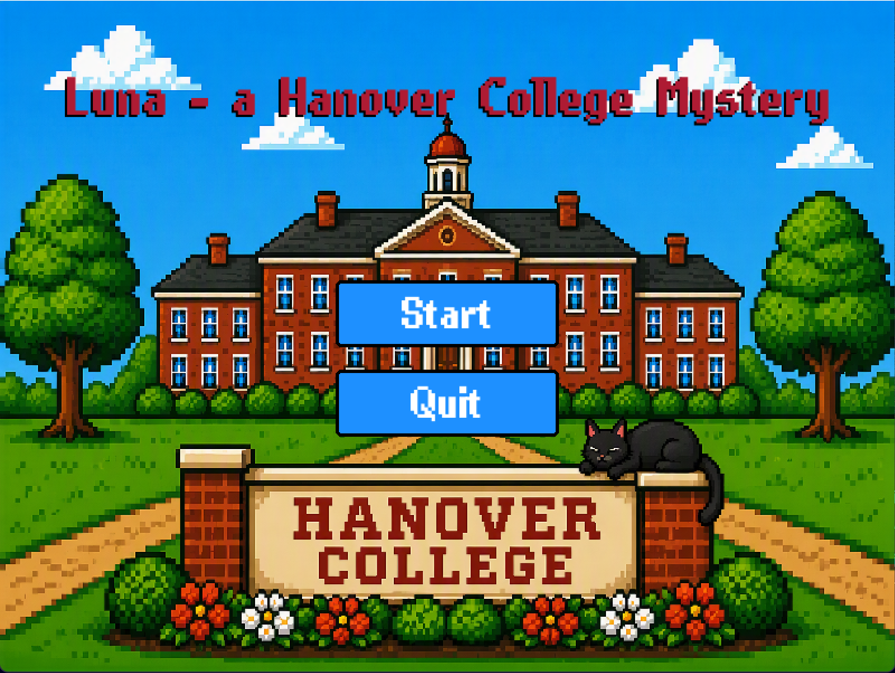

# Luna — a Hanover College Mystery

[](https://github.com/Hanover-CS461/senior-project-2026-2027-Oxiel-Castro/actions/workflows/tests.yml)

A turn-based cat RPG, built as a Hanover College senior project. Luna's human has
gone missing somewhere on campus, so she searches a clickable map of buildings,
fights the creatures guarding each one, and has to reach her human before she is
defeated.

**[Play in your browser](https://hanover-cs461.github.io/senior-project-2026-2027-Oxiel-Castro/game/)** ·
[Project proposal](proposal/proposal.md)



Every run is seeded, so the human's location changes but can be reproduced from a
seed. Combat is JRPG-style menu combat built around one tension: spend Focus on
strong actions, or Rest to refuel and give the enemy a free turn.

## Play

- **Browser:** [play the web build](https://hanover-cs461.github.io/senior-project-2026-2027-Oxiel-Castro/game/) — nothing to install.
- **Desktop:**

  ```bash
  pip install pygame-ce
  python game/main.py
  ```

  Run that from the repository root: the asset paths in `config.py` are relative to
  it. Requires Python 3.11 or newer.

## Controls

All menus are mouse-driven.

- **Seed box (title screen):** type digits, Backspace to delete, Enter to unfocus.
  Leave it empty for a random seed.
- **Intro scenes:** Space or Enter advances, Esc skips.

## How it's built

| Path | What it does |
| --- | --- |
| `game/main.py` | Game loop, screen routing, input, and all drawing |
| `game/battle.py` | Pure battle logic — a state machine with no pygame dependency |
| `game/run.py` | Seeded run state: buildings, enemies, rewards |
| `game/config.py` | Constants, colors, and asset paths in one place |
| `game/assets.py`, `game/sprites.py` | Asset loading, frame cropping, and caching |
| `game/ui.py` | Buttons, bars, and text helpers |
| `game/story.py`, `game/messages.py` | Intro scenes and paged battle narration |
| `game/transitions.py`, `game/music.py` | Screen transitions and audio |
| `tests/` | Unit tests for the battle logic |

The split is deliberate: `battle.py` imports nothing from pygame, so the combat
rules can be tested without opening a window.

```bash
python3 -m unittest discover -s tests
```

## Docs

- [Project proposal](proposal/proposal.md) — design, core systems, and run structure
- [Pygame sprites tutorial](proposal/tutorial/index.md) — how the sprite sheets and animation work
- [Slides](proposal/slides/slides.md)
- [Bibliography](bibliography.md)


Built with [pygame-ce](https://pyga.me/).


